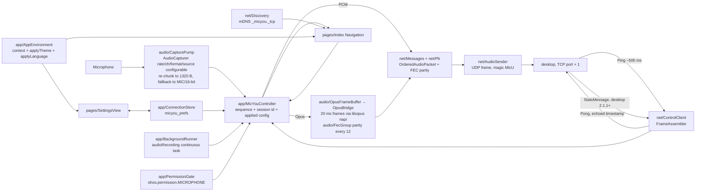

# Repository Guidelines

## Overview

HarmonyOS NEXT client for MicYou: captures microphone audio on the phone and streams
it to the desktop server (as PCM or, on-device, as Opus) over the same wire protocol
the Android client uses. One `entry` HAP module: ArkTS plus a single napi native
module (`libmcyopus.so`, wrapping libopus). No third-party ArkTS/runtime dependency —
`entry/oh-package.json5` carries only the local types package
`"libmcyopus.so": "file:./src/main/cpp/types/libmcyopus"`, and the proto3 codec under
`net/` is hand-rolled. The one native C dependency is libopus (BSD-3), tracked as a
git submodule at `lib/opus` pinned to v1.5.2.

bundleName `com.zhh7ce.micyou.hmos`, vendor `zhh7ce`, main element `EntryAbility`.
Two pages: `pages/Index.ets` (the `Navigation` host and home screen) and
`pages/SettingsView.ets` (a `NavDestination` pushed by route name `settings`).
Upstream project (desktop server + Android + iOS clients):
[github.com/MicYou-Dev/MicYou](https://github.com/MicYou-Dev/MicYou).

## How it runs

One ability, two pages (host + settings destination), one controller and one
preferences store, both process-wide singletons.

`EntryAbility.onCreate` calls `AppEnvironment.publish(this.context)`, which stores the
`UIAbilityContext` (pages must not use the deprecated `getContext()`) and kicks off
`ConnectionStore.ensureInit(context)` so the asynchronous preferences load overlaps
with window/page startup. `onCreate` chains `.then(() => AppEnvironment.applyTheme())`
on the same promise to push the stored theme (0 system / 1 light / 2 dark) via
`context.setColorMode`. `onWindowStageCreate` loads `pages/Index`. `onDestroy` calls
`controller.stop()` so swiping the app away tears the session down, then
`AppEnvironment.forget`.

`Index.aboutToAppear`:

1. `controller.attach(snapshot => applySnapshot(snapshot))` so `EngineSnapshot`
   deltas flow into the page's `@State` fields
2. `discovery.onFound = server => remember(server)` then `discovery.start(context)`
   — mDNS browse for `_micyou._tcp`. A browse event only carries the instance name,
   so `Discovery` resolves it via `mdns.resolveLocalService` to get the address.
   `startSearchingMDNS()` has to be called explicitly or no event arrives at all
3. `await ConnectionStore.shared.ensureInit(context)`, then
   `prefillFromLast(store.last)` to seed the manual host/port inputs with the last
   successful server
4. `maybeAutoConnect()` — only if `settings.autoConnect` is on, `store.last` is not
   null, the engine is Idle, and the process has not been manually stopped
   (`controller.wasManuallyStopped()`); it waits `AUTO_CONNECT_DELAY_MS = 1500` so
   mDNS has a window to re-resolve a possibly changed IP before committing to the
   stored address, and a same-name discovery overrides the stale host/port

Tapping the FAB (`toggleRun`) either starts a session through
`controller.start(context, host, port, name)` or stops it. Discovered rows select the
target; the manual `TextInput` pair overrides the selection.

`MicYouController.start(context, host, tcpPort, name)` runs in this order:

1. If already Connecting/Streaming, return. Reset `stopping=false`,
   `manuallyStopped=false`. **Fresh `ControlClient` and `AudioSender` instances are
   constructed every session** (a HarmonyOS `TCPSocket`/`UDPSocket` cannot be
   re-connect()/bind()-ed once closed). `sessionCounter += 1`, `sequence = 0`
2. Phase → `Connecting`
3. `ensureMicrophone(context)` — denied → phase `Failed`, return
4. Wire `control.onInbound` / `control.onClosed` callbacks
5. `await control.open(host, tcpPort, sessionId)` — TCP, `MicYouCheck1`/`2`
   handshake, `ConnectMessage{sessionId, platform = "harmonyos"}`
6. `await audioOut.start(host, udpPortFor(tcpPort))` — UDP bind, target port = control
   port + 1
7. `await background.start(context)` — `audioRecording` continuous task with a
   wantAgent back to this ability
8. Read `ConnectionStore.shared.settings` into a `CaptureConfig { sampleRate,
   channels, audioFormat, sourceType }` plus `wantOpus = settings.codec ===
   CODEC_OPUS`; a stored Opus session whose rate is not libopus-native or whose
   format is not 16-bit is clamped to 48 kHz / 16-bit before the pump starts
   (warn log `MicYouEngine`); `applied = await pump.start(pcmSink, levelSink,
   config)`; stash `applied.sampleRate/channels/audioFormat` into
   `capSampleRate/capChannels/capFormat`; in Opus mode also
   `encoder.create(applied…)`, `frameBuffer.start(applied…)`,
   `fecGroup.reset()` and `capCodec = CODEC_OPUS`, otherwise `capCodec = CODEC_PCM`
9. Phase → `Streaming`, start the 1 s watchdog
10. Fire-and-forget `ConnectionStore.shared.recordSuccess(name, host, tcpPort)` —
    only a real success reaches history, a mistyped manual address never pollutes it

Any throw runs `await teardown()` (watchdog → pump.stop → frameBuffer.reset →
fecGroup.reset → encoder.destroy → audioOut.stop → background.stop → control.close)
and sets phase `Failed` with the reason.

Data path: `CapturePump`'s `on('readData')` callback concatenates its carry-over
buffer with the new chunk, slices at `UDP_PCM_PAYLOAD_SIZE = 1320` bytes, hands each
slice to `MicYouController.onPcm`, and computes a linear RMS on the correct PCM view
(int16 / int24 packed / float32) for `onLevel`; the controller throttles snapshot
republishing to `LEVEL_PUBLISH_INTERVAL_MS = 100`. PCM mode encodes each slice
straight into an `OrderedAudioPacket` via `encodeAudioPacket(payload, seq, Date.now(),
sessionId, capSampleRate, capChannels, capFormat, CODEC_PCM)` and sends it. Opus mode
feeds the slices to `OpusFrameBuffer`, which accumulates them into whole 20 ms S16LE
frames (1320 does not divide 1920, so a remainder is carried across calls); each frame
goes through `OpusBridge.encode` (native `opus_encode`) and is sent as an
`OrderedAudioPacket` with `codec = CODEC_OPUS`. Every encoded packet is also handed to
`FecGroup`; on the twelfth packet the group closes and the byte-wise XOR parity goes
out as a separate frame via `encodeFecParityPacket`. In both modes the controller
encodes from `capSampleRate/capChannels/capFormat` — always the **applied** config —
so the wire header can never disagree with the actual capture.

Watchdog ticks every 1 s: fails the session when `control.isHeartbeatStale()` (no
ping for `HEARTBEAT_TIMEOUT_MS = 5000`) or `audioOut.sendFailedHard()` (500
consecutive UDP failures); otherwise republishes the snapshot so `packetsSent` keeps
climbing even against desktop builds that never send `StatsMessage`.

`toggleMute` flips `snapshot.muted`, publishes, and (only when Streaming) calls
`control.sendMute`. Inbound `MuteMessage` is decoded but not acted on.



## Wire protocol

Source of truth is `tauri-app/crates/micyou-protocol/proto/network.proto` in the
desktop repo; `net/` is a hand-written proto3 codec for the subset this client needs,
with no protobuf dependency. Field numbers are mirrored in `net/Messages.ets`
(`WRAPPER_*`, `ORDERED_*`, `AUDIO_*`, `CONNECT_*`, `MUTE_*`, `STATS_*`), frame and
audio constants in `net/Wire.ets`.

- a frame is an 8-byte big-endian header (`i32 magic`, `i32 length`) plus the
  payload — `MicY` (`0x4d696359`) on TCP, `MicU` (`0x4d696355`) on UDP
- a wrong magic or a length outside `0..1 MiB` terminates the connection rather than
  trying to resync the stream
- TCP starts with the handshake (`MicYouCheck1` out, the 12-byte `MicYouCheck2` in)
  and continues with `ConnectMessage { sessionId, platform = "harmonyos" }`,
  `MuteMessage`, `PingMessage`/`PongMessage` and `StatsMessage`
- the desktop owns heartbeat timing: it pings, this client answers with the timestamp
  it received and never pings on its own; `ControlClient.lastPingAt` is what the
  stale check reads
- audio goes to the control port + 1 (`udpPortFor`). Payload is fixed at 1320 bytes
  so a datagram stays under the 1472-byte IP-fragmentation limit; frame size is
  `bytesPerSampleFor(audioFormat) * channels`, so packet duration varies with the
  applied config — 13.75 ms at 16-bit / mono / 48 kHz, roughly half that for stereo
  or float32. The Opus branch slices PCM at the same 1320 bytes but re-accumulates
  the slices into whole 20 ms frames (320 samples per channel at 16 kHz, 960 at
  48 kHz), so each datagram carries encoded packets whose size is far below 1320
- `codec` on the wire is PCM (`0`) or Opus (`CODEC_OPUS = 1`); the controller sets
  `capCodec` from the stored `settings.codec` per session. Opus is encoded on-device
  by the napi module `libmcyopus.so` in VOIP application mode, 20 ms frames, VBR on,
  DTX on, `OPUS_SET_SIGNAL(OPUS_SIGNAL_VOICE)`; in-band FEC is deliberately off
  because the desktop's decode path never requests it (`decode_fec` is always false),
  so it would only add wasted bits. Accepted rates are libopus's native
  {8000, 12000, 16000, 24000, 48000} Hz at 1 or 2 channels; `SettingsView` gates the
  choices and the controller clamps a stored incompatible combo to 48 kHz / 16-bit
  before the pump starts. Against libopus 1.5.2, DTX silence encodes to 1-byte
  TOC-only packets, never 0 bytes, so sequence numbers keep advancing while nobody
  speaks. Measured uplink on the test phone at 48 kHz mono: about 10.6 KB/s Opus
  versus about 97 KB/s PCM
- `audioFormat` uses the Android `AudioFormat` constants the desktop decoder keys
  on: `AUDIO_FORMAT_16BIT = 2`, `AUDIO_FORMAT_FLOAT32 = 4`, `AUDIO_FORMAT_24BIT = 6`.
  These are the three branches verified on the desktop's `validate_audio_packet` /
  PCM decode path; other encodings (including 32-bit integer PCM) have no branch
  there, so the UI does not offer them
- FEC fields (`fecBuffer`, `fecSequenceNumber`, `fecPacketLengths`) stay unset on
  the PCM path, which `validate_audio_packet` accepts when the lengths are empty.
  The Opus path sends one out-of-band XOR parity packet per 12 audio packets
  (`FEC_GROUP_SIZE`): the parity frame carries `fecBuffer = [0x01]` (the non-empty
  marker the desktop uses to detect parity under the ExplicitMarker layout),
  `fecSequenceNumber` = the group's first sequence number (group 0 omits it —
  proto3 decodes an absent varint as 0), `fecPacketLengths` = the 12 source lengths
  as packed uint32s, and the byte-wise XOR (zero-padded to the longest source) in
  `audioPacket.buffer` with `codec = 1`. The parity packet takes the next sequence
  number without consuming it — the following audio packet reuses that number, so
  the audio-side sequence stays gap-free (`MicYouController.onOpusFrame`, comment
  citing Android `AudioEngine.kt:970-972`); partial groups are dropped at reset
  because desktop recovery needs exactly 11-of-12 sources
- `optional bool is_muted` must be present on the wire even when false, or the
  desktop reads `None` — hence `PbWriter.writeOptionalBool` instead of skipping zero
  values
- `StatsMessage` mixes types: `rttMs` and `latencyMs` are `int32` (varint) while
  `jitterMs` and `packetLoss` are `float` (fixed32 little-endian, decoded as
  float32) — `readStats` branches on the wire type instead of assuming both
- `SOURCE_*` constants (`SOURCE_MIC=0`, `SOURCE_VOICE_RECOGNITION=1`,
  `SOURCE_VOICE_COMMUNICATION=7`, `SOURCE_CAMCORDER=13`, `SOURCE_UNPROCESSED=14`,
  `SOURCE_LIVE=17`) match the raw values of HarmonyOS `audio.SourceType`; they are
  what `ConnectionStore` persists, and `CapturePump.mapSource` translates each to
  the concrete enum member at capture time
- `CapturePump.start` catches a `createAudioCapturer` failure (unsupported combo,
  capture focus conflict), releases the half-built capturer if it got that far, and
  reopens with `SOURCE_MIC` + `AUDIO_FORMAT_16BIT`. It returns a `CaptureApplied`
  reflecting the config actually in effect; `MicYouController` encodes every wire
  header from that snapshot so the header cannot disagree with the bytes being sent

## Modules

`entry/src/main/ets/`, plus one napi native module under `entry/src/main/cpp/`, all
inside the single `entry` HAP module:

| File | Role |
|---|---|
| `entryability/EntryAbility.ets` | ability shell: publishes the context via `AppEnvironment.publish`, chains `applyTheme` on the preferences load, loads the page, stops the engine on destroy |
| `app/AppEnvironment.ets` | static holder for the `UIAbilityContext` plus the `MicYouController` and `ConnectionStore` singletons; `applyTheme` (via `context.setColorMode`, API 18+) and `applyLanguage` (via `i18n.System.setAppPreferredLanguage`, effective on cold restart); `languageTag(index)` maps 0/1/2/3 to `default`/`en`/`zh-CN`/`zh-TW` |
| `app/MicYouController.ets` | the engine: `EnginePhase` machine, start/teardown order, mute, watchdog, `EngineSnapshot` publishing at 1 Hz (plus on level, throttled to 100 ms); stashes per-session `CaptureApplied` and encodes every wire header from it; tracks `manuallyStopped` so auto-connect cannot restart the mic after the user stopped |
| `app/ConnectionStore.ets` | `@ohos.data.preferences` singleton under `micyou_prefs`: last server, capped history (10, dedup by `host:port`, `connectCount`), auto-connect, theme, app language, sample rate, channel count, audio format, codec, source type. History is stored as parallel primitive arrays, not one JSON blob. `recordSuccess` fires only from the controller's success branch |
| `app/PermissionGate.ets` | `ohos.permission.MICROPHONE` through `requestPermissionsFromUser` |
| `app/BackgroundRunner.ets` | `audioRecording` continuous task with a wantAgent back to this ability |
| `audio/CapturePump.ets` | `AudioCapturer` in callback mode (`on('readData')`), re-chunks into 1320-byte payloads with a carry buffer, tail-flushes on stop; per-format RMS level metering; falls back to `SOURCE_MIC` / 16-bit on `createAudioCapturer` failure |
| `audio/OpusFrameBuffer.ets` | accumulates the pump's 1320-byte PCM slices into whole 20 ms S16LE frames with a carry buffer (1320 does not divide 1920); `reset()` drops the sub-frame remainder at session stop — no padding, no partial encode, same as Android |
| `audio/OpusBridge.ets` | thin ArkTS wrapper over `libmcyopus.so` (`createEncoder`/`encode`/`destroyEncoder`); one encoder handle per session, created after the pump reports the applied config; all calls stay on the main JS thread because the native module keeps global slots without locking |
| `audio/FecGroup.ets` | collects 12 encoded opus packets and hands back the byte-wise XOR parity (zero-padded to the longest source), the 12 original lengths and the group's start sequence; partial groups are discarded on reset |
| `net/Wire.ets` | frame header, handshake bytes, `FrameAssembler`, protocol constants (`PACKET_MAGIC`, `UDP_PACKET_MAGIC`, `UDP_PCM_PAYLOAD_SIZE`, `CODEC_*`, `AUDIO_FORMAT_*`, `SOURCE_*`, `OPUS_FRAME_MS`, `FEC_GROUP_SIZE`), `udpPortFor`, `bytesPerSampleFor`, `opusFrameSamples`/`opusFrameBytes`, `isOpusNativeRate` |
| `net/Pb.ets` | minimal proto3 `PbWriter`/`PbReader`: varint, length-delimited, fixed32, packed repeated uint32 (`writePackedUInt32s`). 64-bit values are encoded by repeated division so they stay exact inside the double range without BigInt |
| `net/Messages.ets` | message encoders and the inbound decoder, keyed by the proto field numbers. `encodeAudioPacket` takes `audioFormat` and `codec` as parameters and never writes FEC fields; `encodeFecParityPacket` builds the out-of-band XOR parity frame |
| `net/ControlClient.ets` | TCP control connection: connect, handshake, frame dispatch, pong reply, heartbeat supervision (`isHeartbeatStale`, `silenceMs`) |
| `net/AudioSender.ets` | UDP sink, oversized-datagram guard, consecutive-failure counter (`sendFailedHard`) |
| `net/Discovery.ets` | mDNS browse plus resolve for `_micyou._tcp`, reported as `DiscoveredServer` |
| `pages/Index.ets` | Navigation host + home screen, laid out to match Android `MobileHome`: header card (logo + title/subtitle + settings gear pushing `settings` route), connection card (rescan button, discovered list with selection, manual host/port `TextInput` pair), control card (status text + optional LIVE badge + peer + `Progress` ring around a centered FAB + failure line), bottom bar (mute pill + status dot). `navDestination(this.routeMap)` returns `SettingsView` for name `settings`. No link statistics render on this screen — Android parity |
| `pages/SettingsView.ets` | `NavDestination` (hidden title bar) with a back chevron pushing `onBack()`. Sections: Appearance (theme chips, language chips), Audio (source chips filtered by `deviceInfo.sdkApiVersion`, sample-rate chips, channel chips, bit-depth chips, codec chips PCM/Opus — with Opus selected, non-libopus-native rates and non-16-bit depths are greyed at `opacity(0.5)` and not clickable, and a stored incompatible rate/format is rewritten to 48 kHz / 16-bit and persisted both on page load and on the codec toggle), Connection record (auto-connect `Toggle`, last-server card, history rows with per-row delete + `×N` count, clear-all), About. Reads and writes through `ConnectionStore.shared`; changes to theme call `AppEnvironment.applyTheme()`, language calls `AppEnvironment.applyLanguage()` and show a restart hint |
| `entry/src/main/cpp/` | the napi module `libmcyopus.so`: `napi_init.cpp` exposes `createEncoder`/`encode`/`destroyEncoder` around libopus, taking exactly one 20 ms S16LE frame per call; `CMakeLists.txt` `add_subdirectory`s the libopus git submodule at `lib/opus` (v1.5.2, BSD-3, licence text in `lib/opus/COPYING`) and forces the libopus build options in-file; the ArkTS side binds through `cpp/types/libmcyopus/index.d.ts` |

## UI rules

- `Index` hosts `Navigation(this.pathStack) { … }` with
  `mode(NavigationMode.Stack)`, `hideTitleBar(true)` and
  `.navDestination(this.routeMap)`. Routes are strings; only `settings` exists today.
  Push with `pathStack.pushPath({ name: 'settings' })`, pop with `pathStack.pop()`
  from the destination's `onBack`. No `@ohos.router`
- no link statistics on the phone screen — RTT / jitter / loss / latency still
  populate `EngineSnapshot` for future use, but the home screen deliberately omits
  them so it mirrors Android `MobileHome`. Anything Android does not show on the
  home screen lives in Settings instead (connection history, last connected,
  auto-connect, theme, language, audio settings)
- **a `@Builder` re-renders on state changes only when it takes a single
  object-literal parameter.** `statRow(label, value)` with plain values renders once
  and then freezes — the stat rows go through `statRow({ label: …, value: … })`
  typed as `StatRowArgs` for exactly that reason. New builders that display state
  must keep that shape. `SettingsView`'s chip builders all follow the same pattern
  (`themeChip(choice: ThemeChoice)`, `sourceChip(choice: SourceChoice)`, …)
- `AppEnvironment.controller` and `AppEnvironment.connectionStore` are singletons, so
  the engine and the store survive a page rebuild; `attach` in `aboutToAppear` and
  `detach` in `aboutToDisappear` keep a dead page from being observed.
  `Index.aboutToDisappear` also clears `ConnectionStore.shared.onChanged`
- all colors go through `$r('app.color.xxx')`. Every Material 3 role used by the UI
  (`primary`, `on_primary`, `primary_container`, `surface`, `surface_bright`,
  `surface_container`, `surface_container_high`, `surface_container_highest`,
  `on_surface`, `on_surface_variant`, `outline`, `tertiary`, `error`,
  `error_container`, `on_error_container`, `live_badge`) is declared in
  `resources/base/element/color.json` with a dark counterpart in
  `resources/dark/element/color.json`. No hardcoded hex in `.ets`
- icons use `SymbolGlyph($r('sys.symbol.<name>'))` — chevron_left, gearshape,
  arrow_clockwise, link / link_slash, mic_fill / mic_slash, checkmark_circle_fill,
  circle_fill, xmark. The header shows the app's own mark via
  `Image($r('app.media.app_logo'))` — a flat microphone tile, not an upstream MicYou
  asset. Every icon PNG (header mark, start window icon, and the layered launcher
  foreground/background in both `AppScope` and `entry`) is drawn by
  `scripts/gen_logo.py` (Pillow); rerun it after editing the geometry constants
- API-gated UI: `SettingsView.aboutToAppear` reads `deviceInfo.sdkApiVersion` and
  `availableSources()` filters `SOURCE_CHOICES` by `minApi`. Compile-time members
  whose `@since` is above the baseline (CAMCORDER at 13, UNPROCESSED at 14, LIVE at
  20) still compile because the local SDK is API 26; the runtime filter keeps them
  off the visible list on older devices

## Toolchain on this machine

DevEco Studio lives at `/opt/devecostudio`, SDK at `/opt/devecostudio/sdk/default`
(OpenHarmony + hms). `hvigorw` (6.26.2) and `ohpm` (26.0.0.410) are symlinked into
`/usr/bin`; `codelinter` is not, and see below. Node is v26.11.1.

`DEVECO_SDK_HOME` is not set globally — export it per shell or every hvigor
invocation fails.

```bash
export DEVECO_SDK_HOME=/opt/devecostudio/sdk
```

`hdc` is not on PATH either. It ships inside the SDK:

```bash
HDC=/opt/devecostudio/sdk/default/openharmony/toolchains/hdc   # Ver 3.2.0e
```

## Build

```bash
export DEVECO_SDK_HOME=/opt/devecostudio/sdk
hvigorw assembleHap --no-daemon      # ~1 s warm, writes both HAPs below
hvigorw clean --no-daemon
hvigorw tasks --no-daemon            # task list; assembleHap is module-scoped, not listed
```

One prerequisite before the first build: libopus is a git submodule, so
`git submodule update --init` has to fetch it (`.gitmodules` → `lib/opus`,
`https://github.com/xiph/opus.git`, pinned to tag v1.5.2). The native build is driven
by the tracked `entry/build-profile.json5` `externalNativeOptions`
(`./src/main/cpp/CMakeLists.txt`, `abiFilters: ["arm64-v8a"]`) with an intentionally
empty `arguments` string — the libopus build options are `set(... CACHE BOOL "" FORCE)`
inside `CMakeLists.txt`, so no machine-local profile can silently change what gets
compiled. Measured in the signed HAP (arm64-v8a): `libmcyopus.so` 594,568 B,
`libc++_shared.so` 1,262,504 B, total `entry-default-signed.hap` 2,326,054 B.

Output in `entry/build/default/outputs/default/`:

- `entry-default-signed.hap` — installable
- `entry-default-unsigned.hap`

Signing already works headlessly: `build-profile.json5` `signingConfigs` points at the
automatic-signing material DevEco generated in `~/.ohos/config/`
(`default_MicYou-HarmonyOS_<hash>.{p12,cer,p7b}`). That profile is bound to the
current bundleName (`com.zhh7ce.micyou.hmos`), so a bundleName change needs
a fresh auto-sign run in the IDE before `assembleHap` can sign again.

The signing block is machine-local, so `build-profile.json5` is gitignored and
`build-profile.example.json5` is the tracked starting point: copy it over, then let
DevEco fill in `signingConfigs` (Project Structure > Signing Configs > Automatically
generate signature). The example keeps the real shape with placeholders in the key
positions, so building with it unedited fails at the signing step; an empty
`signingConfigs` array still builds and yields `entry-default-unsigned.hap`.

## Lint

`code-linter.json5` exists (performance + typescript-eslint + the
`@security/no-unsafe-*` crypto rules), but the CLI is unusable as a normal user:
`/opt/devecostudio/tools/bin/codelinter` aborts with `Failed to execute CodeLinter`
and writes no report, because `/opt/devecostudio/tools/codelinter/linter/result/` is
`root:root 0755`. Lint through DevEco Studio, or chown that directory first.

## Tests

None in the project. `entry/src/` contains only `main` — no `ohosTest`, no `test`,
and no test runner wiring. Verification is a build plus a manual pass on a real
phone.

Out of tree, the proto3 codec was round-tripped against `network.proto` with
protobufjs as an independent parser: field numbers, wire types and the emitted bytes
matched protobufjs' own encoder, the float32 stats fields decoded correctly, the FEC
parity packet round-tripped (`[0x01]` marker, group-start `fecSequenceNumber`, 12
packed lengths), and regular audio packets were asserted never to leak FEC fields;
`FrameAssembler` survived both byte-at-a-time and coalesced delivery. Re-run that
check (in a scratch directory, protobufjs is not a project dependency) whenever
`net/Pb.ets` or the field numbers in `net/Messages.ets` change.

End-to-end on the nova 14 Pro against the desktop GUI: discovery → connect → 48 kHz
callback capture → UDP at about 73 datagrams/s → desktop decode with 0.00 % loss,
0.7-0.9 ms jitter and 8-11 ms round trip.

## Device

The test phone is a HUAWEI MIA-AL00 (nova 14 Pro), `OpenHarmony-6.1.1.120`,
`const.ohos.apiversion` 24, serial `<run $HDC list targets to see your own>`. It
enumerates as USB `12d1:1101` "HDC Device".

There is no udev rule for it and Arch ships `/dev/bus/usb` nodes as `root:root 0664`
with no `usb` group. Access works because logind attaches an ACL for the seat user to
the node (`getfacl /dev/bus/usb/001/00N` shows `user:zhh7ce:rw-`). If `hdc list
targets` prints `[Empty]` with `libusb_open fail xret -3`, the ACL is missing — replug
the phone on an active session rather than hunting for a udev rule. Diagnose with a
manual server:

```bash
OHOS_HDC_LOG_LEVEL=5 $HDC -l 5 -m -s 127.0.0.1:8710
```

## Debug loop

```bash
$HDC list targets
$HDC install -r entry/build/default/outputs/default/entry-default-signed.hap
$HDC shell hilog -r                                        # clear the buffer
$HDC shell "aa start -b com.zhh7ce.micyou.hmos -a EntryAbility"
$HDC shell aa force-stop com.zhh7ce.micyou.hmos
$HDC shell pidof com.zhh7ce.micyou.hmos                  # 0 exit status means running
```

Logs. Every file declares `DOMAIN = 0x3307` and its own tag: `MicYouAbility`,
`MicYouEngine`, `MicYouControl`, `MicYouAudioOut`, `MicYouCapture`,
`MicYouDiscovery`, `MicYouPermission`, `MicYouBackground`, `MicYouStore`,
`MicYouEnv`. App lines render as `A3307/com.zhh7ce.micyou.hmos/<TAG>`.

```bash
$HDC shell "hilog -x -P <pid>"                  # non-blocking dump, filtered by pid
$HDC shell "hilog -x -T MicYouEngine"           # by tag
$HDC shell "hilog -x -L W,E,F"                  # warnings and up
$HDC shell hilog                                # blocking follow
```

Two things eat the app logs on this device:

- the `app` buffer is only 512 K (`hilog -g`), and
- NETSTACK floods it with `get TFO failed, fd=…, errno=95` several times a second
  while a socket is open, so domain/tag filters come back empty even when the app did
  log.

Filter by pid, not by domain, when streaming. `hilog -Q pidoff` disables per-process
flow control if lines are still being dropped.

UI inspection without the IDE — read the layout text instead of taking screenshots:

```bash
$HDC shell "uitest dumpLayout -p /data/local/tmp/l.json" && $HDC file recv /data/local/tmp/l.json .
$HDC shell "uitest uiInput click <x> <y>"       # coordinates from the dumped bounds
```

File transfer and a device shell:

```bash
$HDC file send <local> <remote>
$HDC file recv <remote> <local>
$HDC shell
```

## API surface

The `.d.ts` files under `/opt/devecostudio/sdk/default/openharmony/ets/api` (plus
`kits/`) are authoritative — check them instead of web docs, which regularly describe
fields this SDK does not have. Concretely, on this project:

- `AudioCapturerOptions` has no `ioType`, and no `AudioStreamLowLatencyPriority`
  exists at all; `AudioCapturerInfo.capturerFlags` must be `0` (no "force raw" /
  "force 3A" flag)
- `mdns.DiscoveryService` needs an explicit `startSearchingMDNS()` before any event
  fires
- `audio.SourceType` members available in this SDK: `MIC` (0, @since 8),
  `VOICE_RECOGNITION` (1, @since 9), `VOICE_COMMUNICATION` (7, @since 8),
  `CAMCORDER` (13, @since 13), `UNPROCESSED` (14, @since 14), `LIVE` (17, @since
  20). There is no `VOICE_PERFORMANCE`, no `MIC_FAR`/`MIC_NEAR`, no
  `REMOTE_SUBMIX`, no `SOURCE_TYPE_DEFAULT`. No API enumerates supported sources;
  the only probe is `AudioStreamManager.isRecordingAvailable` (API 20), above the
  compile baseline. Practical path: try `createAudioCapturer` and fall back to `MIC`
  on failure — exactly what `CapturePump` does
- the `SOURCE_TYPE_VOICE_COMMUNICATION` doc is explicit: 3A only engages when a
  `STREAM_USAGE_VOICE_COMMUNICATION` / `_VIDEO_COMMUNICATION` `AudioRenderer` is also
  playing. MicYou captures only (the audio goes to the PC, not to the phone's own
  speaker), so choosing source 7 buys the route, not AEC
- `context.setColorMode` is API 18+; wrapped in try/catch inside
  `AppEnvironment.applyTheme` so an older device silently keeps the system theme
- `i18n.System.setAppPreferredLanguage` (@since 11) persists app-wide but only
  re-resolves resources on the next cold start; that's why the language section in
  `SettingsView` carries a `lang_restart_hint` string
- `deviceInfo.sdkApiVersion` from `@kit.BasicServicesKit` gives the runtime API
  level used to filter option lists against a member's `@since`, without raising the
  project's `compatibleSdkVersion` baseline
- `LengthMetrics` is exported from `@kit.ArkUI`, not global. `Flex({ space: … })`
  with a `LengthMetrics` value fails type-check ("only refers to a type, but is being
  used as a value here") unless the import is added explicitly
- `@ohos.data.preferences` is fully asynchronous; `ConnectionStore.ensureInit`
  returns a cached `Promise<void>` so `AppEnvironment.publish` and
  `Index.aboutToAppear` can both await it. History is stored as parallel primitive
  arrays under `K_HIST_*` keys, not one JSON blob, so strict ArkTS does not need a
  `Record<…>` cast

`research/audio-source-modes.md` (gitignored) has the full source-mode write-up with
line numbers into the SDK's own `.d.ts`, an Android cross-map and vendor caveats;
consult it before touching `SOURCE_*` handling.

## Against the desktop

The desktop side is a separate repo (`../MicYou`, Rust + Vue). Two version facts
matter here:

- `platform = "harmonyos"` is only recognised by the desktop's uncommitted
  `transport/tcp.rs` patch (a `ClientPlatform::HarmonyOs` branch that labels the
  device "MicYou HarmonyOS"). The released 2.1.0 binaries fall through and show "MicYou
  Mobile"; that is cosmetic, the session works
- `StatsMessage` is sent by the desktop only from 2.1.1 on. Against an older server
  the RTT, jitter, loss and latency snapshot fields stay at their last value while
  the send counter keeps climbing from the watchdog — that is expected, not a stuck
  UI, and the phone screen does not render them anyway

`validate_audio_packet` accepts `channel_count` 1..=2 and honours the declared
`sampleRate` / `audioFormat`; the desktop resamples to 48 kHz on its side. The PCM
decode branches cover 16-bit, float32 and 24-bit packed; 32-bit integer is not
decoded, which is why the phone UI does not offer it.

A quick server for device tests is `cargo run -p micyou-cli -- serve` in the desktop
repo; the GUI listening on `<desktop-lan-ip>:8554` works just as well. Note that any
probe which sends a `ConnectMessage` takes over the active session, so a hand-written
test client will knock the phone off the mic.

## Known gaps

- Wi-Fi mode only: no USB (`hdc` port forwarding) and no web mode
- mute is pushed to the desktop and an inbound `MuteMessage` is parsed but not acted
  on; `PluginMessage` from the desktop is ignored entirely
- the `audioRecording` continuous task has not been tested with the screen off
- auto-connect tries exactly once and does not back off and retry; a real incoming
  call preempting `SOURCE_TYPE_VOICE_COMMUNICATION` capture is a plausible conflict
  path that has not been exercised on the test phone
- on-device RMS gating is not implemented; the phone streams continuously
  whether or not anyone is speaking, so energy saving relies entirely on the desktop
  VAD

## Conventions

- Strict ArkTS: no `any`, explicit types on every declaration including lambda
  parameters, no structural typing tricks. The compiler is unforgiving about
  `| undefined` vs `| null`, so null-check with `=== null` on the locals this
  codebase uses
- Validate at the trust boundary — frame magic, payload length, datagram size,
  handshake bytes, resolved address and port — and keep the inside lean. Fail the
  connection instead of guessing at a corrupt stream
- Never call `getContext()` or cache a context inside a network or audio class; the
  ability context comes from `AppEnvironment` and the transport objects take only
  host/port strings
- Every `.ets` file opens with one header block: `SPDX-License-Identifier:
  GPL-3.0-or-later`, then the standard GPL-3.0-or-later paragraphs with the zhh7ce
  copyright line pointing at `https://github.com/zhh7ce/MicYou-HarmonyOS`
- User-facing strings go in `entry/src/main/resources/{base,zh_CN,zh_TW}/element/string.json`;
  never hardcode text in `.ets`. Adding a key means updating all three
- Colors go through `$r('app.color.xxx')`. Adding a role means editing both
  `resources/base/element/color.json` and `resources/dark/element/color.json`
- Persisted settings follow the same pattern: a module-level `K_<NAME>` constant, a
  field on `ConnectionSettings` with a `DEFAULT_<NAME>` value used in `reload`, a
  `prefs.put` for it in `persist`, and an async setter on `ConnectionStore` that
  writes the field, calls `persist()` and `notify()`. Missing keys fall back to the
  default on read so an upgrade does not have to migrate anything explicitly
- `hilog` format strings use `%{public}s` / `%{public}d`. A bare `%s` is redacted to
  `<private>` on a release device, which silently destroys the debug value of a log
  line
- Technical error text (log messages, wire strings) stays English
- Communication with the user is Chinese; commit messages are English
  `<type>: <description>`
